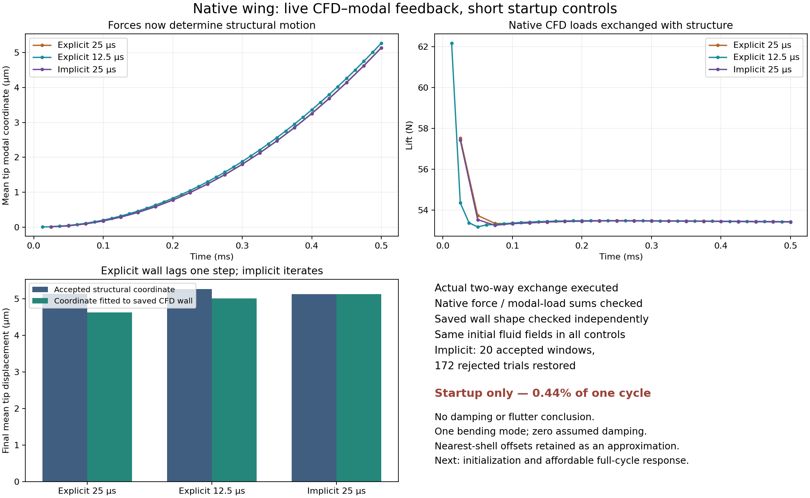

# Native wing live-feedback baseline — 2026-10-30

The native wing now executes two-way OpenCFD–modal feedback through preCICE.
Two explicit controls and an implicit control completed to0.5ms. CFD forces drive
the modal displacement, and the displacement moves the CFD wall. This milestone
establishes the live connection and measures its short-startup sensitivities.
It does not establish damping, flutter, or a full-cycle baseline.

## Model and accepted approximations

Owner direction prioritizes estimating, baselining, tunable correlation and design
deltas. The previously measured nearest-shell offset defect is retained as a
small documented approximation, not a gate against learning from coupled runs.
That does not make the full-shell mapping exactly moment-conservative.
[The contract](COUPLED_BASELINE_CONTRACT.md) records equations, source/runtime pins,
units, modal normalization, coupling semantics and bounds.

The same span32 no-layer mesh, native first-bending shape, rigid iteration-500 fluid
fields and reference face-to-point operator are used in all three runs. All six
initial fluid field hashes agree across controls. The symmetric full wing has
M=0.45423328577302213kg, K=1392.057119541888N/m, f=8.810675Hz for q=mean tip z.
Structural damping is explicitly zero; gravity is absent. Conditions remain30m/s
TAS, zero incidence, cambered closed-TE NACA4412, span2.4384m/chord.1016m, rho
1.2250532683653954kg/m³, fully turbulent k-omega SST, no transition/boundary layers.
This is one bending mode: torsional stability is not represented by this pilot.

The structural initial q,v and endpoint force are zero, while the fluid initially
has a rigid-wing load field. Thus the first structural load is ramped over one
Newmark step. This deliberately untrimmed startup contributes to timestep
sensitivity; it is not an impulsive wind-on experiment from zero freestream.
Loaded trim or consistent initial-load evaluation must precede damping estimates.

## Observed controls

| Quantity |Explicit25μs|Explicit12.5μs|Implicit25μs|
|---|---:|---:|---:|
|Accepted windows|20|40|20|
|Final structural q, μm|5.139711|5.270665|5.133271|
|Saved CFD wall fitted q, μm|4.628690|5.008439|5.132786|
|Final generalized force, N|19.436099|19.439163|19.433081|
|Final lift, N|53.419605|53.431407|53.414669|
|Max fluid Courant|2.08454|1.04212|2.08455|
|Process duration, seconds|170.9|313.1|1072.0|
|Initial/final strict mesh checks passed|2/2|2/2|2/2|

These process durations include setup/export and partially overlapping runs; they
are not isolated performance benchmarks. Full cycles need a cost-conscious plan.
At8.81Hz, the0.5ms window covers only0.44% of one natural period.

The explicit wall matches the previous accepted structural coordinate within
3.4e-21m in the fitted scalar coordinate. The geometric mode-shape residual is
at most1.12e-16m. The explicit final wall/structure differences are0.5110 and
0.2622μm, consistent with one-step staggering. Implicit iteration reduces that
difference to0.0004852μm. The solid's newest displacement is not falsely claimed
as the already-solved explicit fluid geometry.

Halving the explicit timestep changes final structural q by2.4846%; the maximum
common-time generalized-force difference is1.22964N during startup. At the same
25μs timestep, explicit versus implicit final q differs by0.12546%. These are useful
short-window sensitivities, not asymptotic convergence or damping uncertainty.

## Force, work and rollback audits

Across all three controls, native force totals and preCICE-exchanged force sums
agree within1.24e-12N; modal force projected from the native face-force field agrees
within1.21e-13N. This checks the actual pressure/viscous load exchange, density
conversion and coincident face-mesh mapping. Motion uses the identical fixed
reference H with H_face=W H_point; the nearest-shell approximation is unchanged.

Implicit uses constant relaxation0.5, an absolute displacement-vector L2 criterion
of1e-7m and relative force-vector L2 criterion1e-3, max30iterations. These are
predeclared pilot criteria, not the stricter old synthetic-control settings. All
20 native windows report both criteria converged, requiring at most11iterations.
There are172 rejected trials. Complete structural q/v/a/force/time checkpoints
are restored on rejection; all trials are saved. No iteration-cap result is
accepted. This exercises the adapter's native rollback but does not independently
prove restoration of every hidden fluid state variable.

The structural Newmark energy identity has maximum absolute defect2.55e-20J.
That verifies the structural integrator's load-work accounting, not equality of
all fluid and structural energy terms. Right-endpoint wall work versus trapezoidal
structural work over this open startup path is:

|Control|Wall work, μJ|Structural load work, μJ|
|---|---:|---:|
|Explicit25μs|90.0344|99.9441|
|Explicit12.5μs|97.4298|102.5325|
|Implicit25μs|99.8336|99.7947|

The two work measures use different time quadrature; explicit staggering adds a
visible difference. Rejected implicit trials are excluded from the accepted-time
wall-work sum. None of these positive partial-path works is a damping estimate.

## Verification, artifacts and next work

All158 repository tests pass. Seven new offline protocol tests cover force-driven
motion, signed-mode physical equivalence, an independent analytic undamped
oscillator with startup ramp, timestep error reduction, complete retry behavior,
iteration-cap rejection, invalid loads, bounded-run failure and damping energy.
They require no preCICE installation. The local coder's draft was stopped after
an incorrect undamped-equilibrium test assumption; it was not published or reused.
Primary implemented the analytic/protocol tests and owns the native physics work.

[Summary and histories](evidence/coupled-baseline-20261030.json) retain observed
values and hashes. [Experiment sources](evidence/coupled-baseline-sources-20261030/README.md)
are pinned historical drivers, not a portable commercial adapter. The native
archive has105 files,56,821,670bytes, SHA256
`06ea0e9b64f7456b6bff8a3a80a6d8db1ea42981f0e7f930a07908bd069cdaf8`.
PC archive: `G:\projects\openfoam\build\issue38-coupled-evidence.tar.gz`.
PC preview: `G:\projects\openfoam\viewers\coupled-baseline.png`.

Next: consistent initial load or loaded equilibrium, then an affordable full-cycle
response with enough cycles to separate startup. Use explicit/implicit controls
and practical timestep/modal sensitivity to establish useful trend stability.
Add torsional modes before bending-torsion airspeed/stiffness comparisons; compare
matched UVLM/CFD cases; introduce measured modal/tunnel data for correlation and
work-machine NX Nastran/STAR-CCM+/FlightStream adapters. Issue38 stays open for
periodic qualification. No optimization loop or actual-wing flight limit is claimed.
