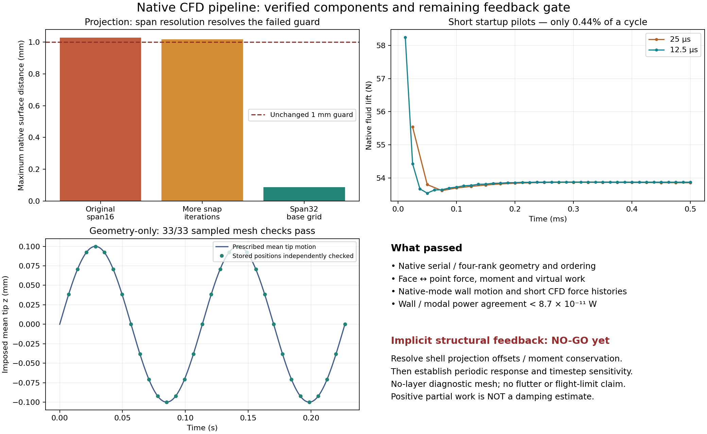

# Native CFD transfer and motion milestone — 2026-10-30

Issue #38 advanced through native prescribed-motion CFD and checked face/point/modal
load transfer. **Implicit structural feedback remains no-go.** The existing native
shell projection needs explicit geometric-offset treatment, and periodic fluid
response is not established. This report does not close all of issue #38.

## What now works

- A no-layer mesh passes the unchanged 1 mm native projection guard and strict mesh
  quality. The successful trial changes only base-grid span resolution 16→32.
- Native first-bending motion passes all 33 sampled quality checks over two cycles.
- Native serial/4-rank interface exports agree, including global addressing,
  coordinates, native face centres, oriented area vectors and face connectivity.
- The new sparse area-fan face/point operator and its transpose conserve force,
  moment and virtual work on actual CFD geometry. Native modes use the same point
  basis for displacement and modal-force projection.
- Two short native-motion flow pilots complete from identical fresh initial fields.
  Their actual integrated CFD forces pass the transfer checks, and the wall/modal
  power comparison is explicitly measured.

Motion remains prescribed. The measured modal force does not yet determine the
next structural displacement. Passing these components is numerical verification,
not viscous-flow validation, flutter prediction or flight clearance.

## Geometry trials: unchanged limits

All trials reuse the closed-TE NACA 4412 provisional shell midsurface from the
retained PR #37 experiment: full span 2.4384 m, chord 0.1016 m. They are newly generated
no-layer diagnostic meshes, not the separate 11.5-million-cell layered mesh.

| Trial | Native projection maximum | Points failing 1 mm | Decision |
| --- | ---: | ---: | --- |
| Retained span16 baseline |1.027259mm|4 of 42,147|Reject native map |
| More snapping iterations only |1.017709mm|2 of 42,143|Still reject |
| Span32 base grid only |0.087077mm|0 of 81,685|Accept for scoped plumbing checks |

The snapping trial increased nSolveIter 50→200 and nRelaxIter 8→40; its mesh quality
passed but projection still failed. The span32 trial restores original snap
settings and changes only `(40 16 20)`→`(40 32 20)` in blockMeshDict. Surface levels,
quality limits and distance guard are unchanged. This supports insufficient
spanwise resolution as a useful diagnosis for this mesh; it is not a universal
meshing rule. The span32 projection 99th percentile is 0.0001024 mm.

The imposed native mode is 8.810675 Hz with 0.1 mm mean tip-z amplitude, symmetric
reflection of the half-shell, and no finite fuselage. Root displacement amplitude
is 4.12e-16 m.32 stored moving states across two cycles match the intended wall
positions within 5.02e-14 m; including the initial state, all 33 strict quality checks
pass. Interior cycle-return offsets remain 6.110 and6.465 micrometres. The moving
mesh is therefore not exactly reversible or demonstrated periodic internally.

## Actual interface checks

The exporter writes 81,685 wing points and 79,284 faces. Four processor face sets
form a disjoint cover; shared points are assembled by native global IDs. Native
serial/parallel coordinates, Cf and Sf agree exactly in this run. Distributed
point-force assembly differs from serial by at most 5.43e-20 N under the nonuniform
synthetic load check. Arbitrary synthetic loads are explicitly distinguished from
native CFD loads in the reports.

For an irregular polygon, equal vertex weights generally do not reproduce native
Cf. The implementation uses triangle-area-weighted vertex contributions, verifies
Cf/Sf, and uses exactly the same weights for W and W-transpose. This preserves
force, moment about both tested origins, rigid motion and virtual work. Storage is
linear in the number of face vertices, not faces times points. See
[usage and limitations](CFD_INTERFACE_TRANSFER.md) and
[the primary design](NATIVE_CFD_TRANSFER_CONTRACT.md).

A 57-point/14-face excerpt of the final native CFD geometry, forces and normalized
mode is retained as a regression fixture, with the complete export hash and exact
selected face indices. 151 repository tests pass, including the native excerpt and
independent irregular-polygon, signed-mode-scaling and negative-input checks.
The earlier eight focused tests also passed in the pinned PC runtime.

## Native prescribed-flow pilots

The accepted mesh gets a fresh 500-iteration rigid simpleFoam initialization; it is
not labeled converged solely from that count. Both pilots use identical saved U,
p, k, omega, nut and phi hashes. No field from the rejected mesh is stretched or
mapped onto this mesh. Conditions: 30 m/s TAS, zero incidence, rho 1.2250532683653954 kg/m³,
nu 1.4605775e-5 m²/s, fully turbulent k-omega SST, no transition model or boundary
layers. Axes are x downstream/y span/z up; full-span area 0.24774144 m²; moment origin
(0.0254,0,0)m. Pressure is kinematic gauge pressure; the native integrated force
field is already dimensional N and is not multiplied by density/area again.

Each pilot starts sine motion at zero displacement but nonzero wall velocity.
This startup is deliberate and cannot establish aerodynamic damping.

| Quantity |25 μs step|12.5 μs step|
| --- | ---: | ---: |
| Completed steps |20|40|
| Physical duration |0.5ms|0.5ms|
| Maximum fluid Courant |2.0846|1.0421|
| Initial/final strict mesh samples passed |2/2|2/2|
| Native force-history sum error |3.27e-13N|3.41e-13N|
| Native moment-history sum error |2.00e-13Nm|2.34e-13Nm|
| Max actual-wall/reference-modal power difference |1.25e-11W|8.61e-11W|
| Right-endpoint partial wall work |54.5361microjoules|54.5816microjoules|
| Final modal force, q=mean tip displacement |19.7080N|19.7143N|

The total duration is only 0.4405% of a cycle. The positive partial work is along
an open upward-motion path under mean lift, not net cycle work or negative damping.
The 0.0834% partial-work change does not establish timestep convergence: maximum
common-time force difference is 1.1117 N, and the smaller-step startup spike occurs
before the first larger-step sample. Coupling-iteration sensitivity and periodic
startup removal remain untested. Flow mesh quality here was sampled at initial
and final states; the separate two-cycle geometry experiment samples more phases.

Actual movingWallVelocity differs locally from the fixed reference operator's
finite-difference velocity by up to 4.48e-7 m/s. Its force-weighted power happens to
agree very closely in these short pilots. This is measured evidence for this
case, not a proof that flux-corrected wall velocity always equals W times point
velocity. Current versus reference face-interpolation velocity differs by only
1.43e-13 m/s over this tiny displacement. Both distinctions remain explicit.

## Why feedback is still no-go

The passing face/point stage is separate from shell-node/CFD-point interpolation.
The retained nearest-surface shell map has partition-of-unity weights, but maps
native structural reference positions to projected positions rather than the
actual off-surface CFD vertices. Its maximum coordinate-reproduction error is
87.077 micrometres, despite passing the 1 mm geometric proximity guard.

For a translation-only projection P, this implies a moment defect
`sum((P*x_shell - x_CFD) cross f_point)` under its force transpose. At the base
pilot endpoint, the maximum component is 8.70e-10 N m; a nonuniform synthetic point
load produces 1.27e-8 N m. The geometric identity needed to guarantee arbitrary-load
moment conservation fails. These are small observed defects, not a physical
hazard claim or permission to silently discard offsets. An explicit offset-aware
kinematic/force treatment, with native rotational DOFs or another verified
linearly complete mapping, must precede a claim of conservative full-shell transfer.
Modal virtual work through the currently prescribed H is still checked separately.

Next work: resolve that shell interface, rerun its native-motion/force checks,
remove startup and establish repeatable closed-cycle response with timestep and
coupling sensitivity, then compare UVLM using matching geometry/reference/kinematics.
The earlier flat soft-torsion UVLM instability example is not a matched comparison
for this cambered prescribed-bending CFD case. A bounded implicit preCICE pilot
must additionally verify checkpoint rollback. No optimization loop is introduced.

## Evidence and retained failures

[Summary JSON](evidence/native-cfd-milestone-20261030.json) contains observed errors,
hashes, reports and the no-go details. [Experiment sources](evidence/native-cfd-sources-20261030/README.md)
retain the primary diagnostic drivers and failed trials. Full native evidence is
on the PC at `G:\projects\openfoam\build\issue38-native-evidence.tar.gz`, SHA256
`deee40860d7f4b68cb414d02efcd41ec19996ba6bd680f7ef8b18bc6d82f5579`.

Exporter attempts are retained: missing meshTools include; unsupported decomposePar
option; wrong proc-addressing local directory; then successful native compile,
serial/parallel export and verification. The final exporter has no added JSON
library dependency. The local coder draft was stopped after primary inspection
found incorrect interpolation/work formulas; primary implemented and checked the
numerical and native integration portion. Independent review follows publication.
