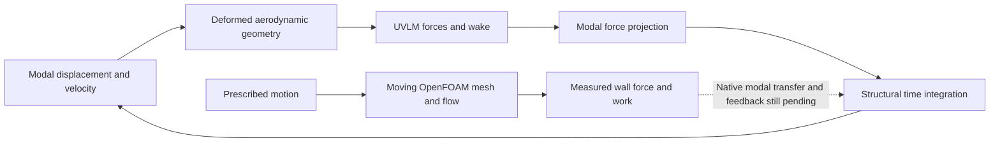

# Overnight FSI results — 2026-10-30

## Open these on the PC

Start with `G:\projects\openfoam\viewers\wing-instability-comparison.html`.
It compares computed decaying motion at **20 m/s** with growing bending and twist
at **25 m/s** in an explicitly hypothetical soft-torsion wing. Slow playback or
scrub toward two seconds. Both panels use the same physical scale.

In the same directory:

- `goland-instability-comparison.html`: independently checked benchmark,
  stable at 150 m/s and growing at 175 m/s.
- `instability-comparison.png`: time histories and numerical sensitivity.
- `extended-wing-fine-mesh-slices.png`: the matching extended-wing CFD mesh.
- `extended-wing-fine-layer-coverage.png`: achieved boundary-layer coverage.
- The earlier equilibrium and airspeed comparison viewers remain available.

The growing motion comes from integrated coupled modal–UVLM equations, including
changing aerodynamic forces. It is not an animation with an assumed growing
envelope. **We have demonstrated instability in diagnostic models; we have not
established flutter of the original aluminum wing.**

## Which loop is closed?

The UVLM path above produced the growing histories. The CFD controls currently
impose motion and measure fluid response; they do not let those loads determine
the wing's next displacement.

## What the instability experiment establishes

The hypothetical example retains native mass and mode shapes, but reduces the
fifth generalized modal stiffness to 1%. First bending remains 8.810675 Hz;
torsion moves from 169.4779 to 16.94779 Hz. It uses a flat, unloaded aerodynamic
reference and explicitly assumes zero physical structural damping. This is a
mechanism experiment, not a realizable structural redesign.

| Aerodynamic discretization | Oscillatory crossing |
| --- | ---: |
| M8 / N16 | 22.56636 m/s |
| M12 / N24 — current wing preview | 23.10665 m/s |
| M16 / N32 | 23.34976 m/s |

These cases use 20 structural modes and matched physical timesteps. The last
change is 1.05%; aerodynamic-grid convergence remains unresolved. Stable motion
at 20 m/s and growing motion at 25 m/s survive all completed checks. Static
divergence is tracked separately. The M16 growing response agrees between
independently stepped descriptor and causal formulations to 6.34e-13; its energy
and aerodynamic-work balance was also checked. An earlier resource-interrupted
M16 attempt remains recorded separately from the successful run.

The [detailed instability report](INSTABILITY_DEMONSTRATION.md) contains growth
rates, frequencies, initialization, branch tracking, mode/wake/grid/timestep
sensitivity and replay checks. **203 repository tests and 32 new browser
combinations passed**, in addition to 96 earlier speed-viewer combinations.
These are software and numerical checks, not experimental validation.

## What advanced in OpenFOAM

The new CFD geometry matches the extended structural dimensions: 2.4384 m full
span and 0.1016 m chord. Its closed-TE NACA 4412 surface is a provisional shell
midsurface, not a verified outer skin. Native checks found a closed, connected
surface without self-intersections. The old shorter-wing flow field was not
stretched onto this geometry. The root is rigid, motion is mirrored, and no
finite fuselage or antisymmetric structural motion is represented.

| Component | Observed result | Interpretation |
| --- | --- | --- |
| Coarse layered mesh | Numerical quality passes; 70.6943% wall-area layer coverage | Fails the 90% layer gate; diagnostic use only |
| Fine mesh | 11,472,632 cells; canonical and chord-scaled quality checks pass | Layers cover 98.8237% of wall area; 69.3481% has all 12 layers |
| Native first-bending boundary motion | All 167,665 wing points mapped; saved positions agree within 5.02e-14 m | Boundary ordering and imposed motion verified |
| Revised native mesh extension | All 13 sampled checks pass over three geometry-only cycles | Improved robustness; does not establish fluid temporal accuracy |
| Layered moving-flow pilots | Serial: one completed microsecond step; parallel: four | Both timed out before their five-step targets |
| Cheap analytic moving-flow control | Short pilots to 0.004 s completed; native force/work observer checked | Prescribed analytic motion, no native structural feedback |

The fine mesh initially exhausted available memory during `checkMesh`; the saved
mesh was checked successfully after memory became available. WSL exposes 32 GiB,
although the PC has 64 GiB physical RAM. Fine-mesh extended diagnostics still
flag 851,982 low-connectivity-determinant cells and 470,779 concave cells, plus
9,825 concave faces. The two failed extended checks remain visible alongside the
passing canonical quality checks. No fine-mesh flow, yPlus or motion
qualification has been completed.

Geometric wall spacing was measured using native `meshWave` nearest-wall distance
at each wing-face owner cell, with native/VTK face identity and area checks.
Where layers exist, the area-weighted median distance is 10.0 micrometres, mean
20.9 micrometres and 95th percentile 80.2 micrometres. Areas without layers reach
838 micrometres. This is not a yPlus result or a claim of resolved viscous flow.
The first extraction attempt produced no wall-distance field; the successful
retry explicitly configured `wallDist`, preserving the failed attempt.

The original native mesh extension failed strict quality checks at three phases,
despite commands exiting zero. It left 215 micrometres of interior offset when
the boundary returned to zero. A dedicated uncorrected displacement Laplacian
improved this without changing fluid schemes or acceptance thresholds. Maximum
interior offsets at successive cycle returns are 6.89, 7.29 and 7.63 micrometres:
smaller, but neither exactly reversible nor proven converged over many cycles.

The layered rigid-flow diagnostic was intentionally stopped after its saved
iteration-300 checkpoint, preserving the incomplete 500-iteration target. The
moving pilots began from iteration 100 without claiming converged initialization.
Serial/parallel native point addressing agrees exactly. Both pilots start sine
motion with nonzero imposed velocity; startup transients cannot establish
periodic aerodynamic work or damping.

The cheap no-layer alternatives exposed another useful failure: native-mode
surface projection exceeded the unchanged 1 mm guard, even after refinement
(maximum 1.02726 mm). The separate analytic control isolates moving-fluid
plumbing from that failed native structural map. It imposes
`u_z = 0.0001 * min(abs(y)/1.2192, 1)^2 * sin(2*pi*8.810675*t)` metres,
with zero imposed x/y displacement. This is not the native structural mode.

## Prescribed CFD timestep comparison

Two runs start from the identical saved 0.004 s fluid/mesh state on the
362,208-cell no-layer mesh, using 100 and 50 microsecond timesteps. They target
0.12 s, enough to observe one complete imposed cycle after that shared start.
The flow is 30 m/s at zero incidence, with rho = 1.225053268 kg/m³,
nu = 1.4605775e-5 m²/s and fully turbulent k–omega SST. Axes are x downstream,
y spanwise and z upward; full-span reference area is 0.24774144 m² and the moment
origin is (0.0254, 0, 0) m. OpenFOAM pressure is kinematic gauge pressure.

The observer sums actual native pressure-plus-viscous wall force and its dot
product with actual moving-wall boundary velocity. Positive power means work
from the fluid to the prescribed wall. Its pilot summed force agrees
with native `force.dat` within 4.96e-12 N over 20 samples. Positive work over an
upward segment is expected even under constant lift; only a closed-cycle balance
can remove that contribution, and periodic/timestep convergence is still needed.

The 100-microsecond run completed to 0.12 s after a retained walltime timeout and
restart from 0.09 s. Nineteen replayed overlap samples agree within 3.21e-10 N in
force. All 26 saved boundary-position checks pass within 5.00e-14 m. However,
**six of 25 sampled moving meshes fail strict quality**: two to four faces fail
the face-twist threshold near the positive displacement peak, from 0.015 through
0.040 s. The four faces at 0.025 s lie on the upper wing surface near the two
tips. This mesh-quality metric is not structural torsional instability. The final mesh passes, which would have hidden these intermediate
failures if checked alone. Solver completion is therefore not case acceptance.

The first observed cycle has about -5.86 microjoules of net fluid-to-wall work
with the 100-microsecond step. This is an unqualified first-cycle diagnostic,
not a damping estimate: mesh quality fails, startup is not periodic, and the
smaller-step comparison remains pending. The early common interval already
shows timestep sensitivity in lift variation.

## Review, evidence and next steps

[PR #37](https://github.com/wcc118/openfoam/pull/37) remains open and deliberately
stacked on the aluminum-shell branch. Nothing has been merged. Independent review
is outstanding: earlier attempts failed harness checks, and the latest reviewer
repeated a query until cancelled. Run `20261030T044521Z-918253` exited 143;
its log/checkpoint and acknowledged outcome are retained. Passing tests do not
substitute for independent review.

[Frozen experiment sources](evidence/extended-cfd-sources-20261030/README.md),
[component evidence](evidence/extended-cfd-components-20261030.json), and the
[mesh report](evidence/extended-wing-fine-mesh-20261030.json) preserve provenance
and failed attempts. Large solver artifacts remain in
`runs/instability-20261030/` on the Spark and timestamped directories under
`/home/foam/projects/openfoam/runs/` in the PC's `OpenFOAM-24.04` WSL distribution.
PC preview transfers were SHA256-checked against their sources.

The next engineering steps are tracked in [issue #38](https://github.com/wcc118/openfoam/issues/38):

1. Resolve native CFD surface mapping and verify work-consistent load transfer.
2. Establish repeatable prescribed-flow force phase and cycle work with timestep,
   mesh and periodic convergence, using a matching UVLM reference case.
3. Close structural feedback through the implicit preCICE participant, then check
   timestep and coupling convergence. The synthetic preCICE flap test does not
   establish this wing's complete interface.
4. Replace artificial modal softening with a physically realizable torsional
   model using section, spar, joint and mass information.

The owner-authorized imperfect models have exposed useful integration failures.
They remain labeled as experiments. No reported speed is a flight limit.

Shared reference records: `memory:337f2d45cfc1ebb42dc6f19be8631c53` informed
the causal replay checks; new results are recorded in
`memory:5408eb34bfbad68577e1c9a5edf135b2` (UVLM instability) and
`memory:0668118c9746502907aa878d212ef8f9` (CFD component checks). GitHub and
the retained native evidence remain authoritative for work state and results.
