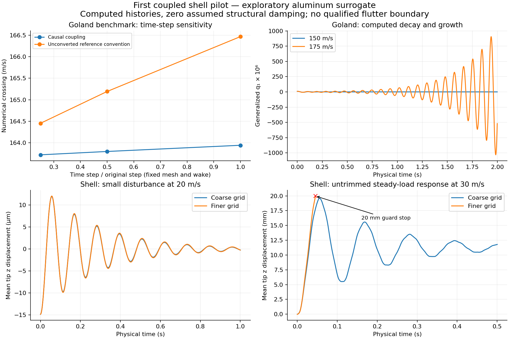

# First coupled shell pilot and time-step study

2026-10-28, issue #36 / PR #37. Owner explicitly requested that simple, imperfect
models be used to test the pipeline and learn from their responses. This increment
therefore executes a shell pilot while retaining the benchmark checks. **These
are exploratory aluminum-surrogate results, not a qualified flutter boundary.**

## What can now be previewed

The standalone [computed-motion viewer](../viewers/wing-coupled-pilot.html)
contains six histories: small disturbances at 20 and 60 m/s and steady-load
response at 30 m/s, each on coarse and finer grids. Download the HTML and open it
locally. Time is physical simulation time; playback rate and geometric
magnification are separate. The animation interpolates recorded modal coordinates,
not a sinusoid. Colors represent displacement, not stress.

## Actual shell modes now drive the coupled response

The pilot consumes the existing native MYSTRAN 30-mode export through its
paired-skin camber maps, retaining the first ten modes without a rigid-section
beam substitution. Generalized masses are one. One full-span aerodynamic surface
mirrors the 48-inch rigid-root half-wing; symmetric modal amplitudes are divided
by sqrt(2). Native half-wing visualization reconstructs displacement as
`sum(phi[k]*q[k])/sqrt(2)`. Antisymmetric response and fuselage interference are
excluded. Root motion is zero. Motion and velocity use the same map and physical
vertex forces use its transpose; random virtual work is checked.

SHARPy's quarter-panel lattice shift is applied to both reference coordinates and
the mode map, by differentiating the same end-to-end strip shift. This retains
local camber motion and the work-conjugate moment arm. The shell is the provisional
4-inch-chord NACA4412, 0.050-inch hollow aluminum surrogate; carbon, spars, overlap
and joint behavior are still absent. Air density is assumed 1.225 kg/m³, freestream
is along +x, and structural damping is assumed zero. The aerodynamic model is
linear incompressible UVLM with a straight eight-chord wake.

Two exploratory configurations were run:

| Case | Chord panels | Span panels per half | CFL | Modes |
| --- | ---: | ---: | ---: | ---: |
| Coarse | 4 | 8 | 1 | 10 |
| Finer | 8 | 16 | 0.5 | 10 |

Both sampled 10,20,30,40,50,60,80,100 m/s. Neither found a growing oscillatory mode
or growing real pole among the analyzed discrete poles at those samples. This is
not an exhaustive stability claim: modes, geometry, damping, resolution and
operating equilibrium remain assumptions. The dominant least-damped branch is
near the in-plane mode; it is not necessarily the visibly excited bending mode.

The cambered native geometry is **not trimmed**. Its nonzero aerodynamic reference
force is recorded. The free-response cases test the homogeneous perturbation
operator as though another load held that reference. Separate cases apply the
steady aerodynamic generalized force at 30 m/s as a constant structural input,
exposing the reference imbalance rather than silently treating it as equilibrium.

The small first-mode disturbance decays in both grids at 20 m/s, with similar
bending histories. The coarse steady-load response peaks near 19.66 mm; the finer
case reaches the predeclared 20 mm camber-component motion guard near 0.046 s and
stops. That guard is an experiment stop, not a failure load, flight limit, or proof
that a small-motion model is accurate below it. The short finer history must not
be interpreted as a later settled response. A defined loaded equilibrium is an
obvious next experiment.

The two grids change both spatial and time resolution, so their differences are
not an isolated convergence study. Generic peak fits at 60 m/s differ substantially
and are not accepted as a uniquely tracked shell damping/frequency measurement.
The viewer retains the actual histories so this can be investigated.

## Benchmark time-step effects are now separated from mesh changes

The Goland benchmark holds the M16/N16-per-half surface, quarter-panel shift,
10-chord wake length and wake spacing fixed. Identical geometry hashes are recorded.
The pinned non-CFL1 wake propagation routine is explicitly supplied each time step;
merely changing `dt` while leaving the CFL1 shift matrix would be wrong. Only one
full-span surface is used. Physical dt is `CFL*chord/(M*speed)`.

| Relative time step | Causal numerical crossing (m/s) | Unconverted reference convention (m/s) |
| --- | ---: | ---: |
| 1 | 163.9402 | 166.4693 |
| 0.5 | 163.7959 | 165.1922 |
| 0.25 | 163.7182 | 164.4514 |

The last causal change is about 0.0475%; the reference-convention discrepancy
shrinks with step refinement. These are roots of reduced discrete systems, not
physical accuracy to four decimal places. Fixed-space wake propagation also has
spatial error; a full mesh/wake/mode convergence claim is not made.

At the quarter step, the predicted growth rates are -2.79195 /s at 150 m/s and
+2.82284 /s at 175 m/s. Independently stepped original-predictor descriptor equations
and causally converted equations agree in their physical response to about 1.1e-13.
A small structural displacement with zero initial circulation gives late peak fits
-2.78698 and +2.82172 /s, respectively. This is a transient check with mixed initial
excitation, not an eigenvector multiplied by its own exponential. Positive-peak
frequency estimates are sampling-dependent; the complete histories are retained.
Adjacent physical modal-shape correlations track the benchmark oscillatory branch.
Real nonoscillatory poles are reported separately from complex poles.

The shifted full-order versus reduced **causal** transfer checks at 50,70,100 rad/s
are below 0.081% relative Frobenius error in all three benchmark time steps. At
55,340,1065 rad/s the shell check is below 0.45% for the tested ten-mode maps.
This aggregate norm is not a per-channel bound or a full-order flutter proof.
All tested aerodynamic reduced systems have spectral radius below one. Zero
physical structural damping and zero Newmark numerical damping are explicit.

## Reproduction and evidence

Primary-owned numerical driver: `scripts/experiments/modal_uvlm_explore.py`.
Use the same pinned SHARPy source/image as the preceding
[benchmark checkpoint](DIRECT_UVLM_VERIFICATION.md). Mount the pinned source
read-only at `/src`, set `PYTHONPATH=/src`, mount scripts at `/experiment`, and
mount an artifact directory containing `goland-native.npz` and the selected
`camber-M*-N*.npz` at `/results`. Networking is disabled; no dependencies installed.

Shell coarse settings: `MODEL=shell PANELS_M=4 PANELS_N=8 WAKE_FACTOR=8 MODES=10
CFL=1 SPEEDS=10,20,30,40,50,60,80,100 TRANSIENT_SPEEDS=20,60 DURATION=1`.
Finer settings change M to8, N to16, CFL to0.5. Benchmark uses defaults M16/N16,
wake10, two modes; run CFL1,0.5,0.25 with distinct CASE_TAG output directories.
Run `python /experiment/modal_uvlm_explore.py`; existing output directories are
rejected. Files `model.npz`, `assessment.json`, `motion.json` retain replay data,
reference loads, maps, numerical checks and status. Exceptions retain a failed
assessment; no failed solve is recorded as a favorable crossing.

Host artifacts are under `runs/uvlm-temporal-20261028/`, including the initial
failed replay attempts. Their zero-frequency Krylov matrices had real values but
complex dtype; an explicit real-if-close conversion with a realness assertion
fixed replay without dropping genuine imaginary coordinates. Corrected runs
completed. Source/mode/report hashes and compact results are in
[evidence JSON](evidence/shell-coupled-pilot-20261028.json). Large matrices and raw
histories remain outside Git; the packaged viewer is the shareable artifact.

## Next useful experiments

Proceed with a defined loaded equilibrium and small disturbances about it; compare
that response with the deliberately untrimmed pilot. Then vary retained modes
(10/20/30), damping and one discretization parameter at a time, guided by observed
response. Actual construction and test calibration remain later steps. No new
OpenFOAM CFD or merge was performed; the existing CFD hold remains.

Validation of the packaged preview: 125 repository tests pass. Headless Chromium
checked all six real histories against the embedded input, including interpolated
q, mean tip displacement, fixed displacement color maxima, magnification-independent
trace, play/pause, stopping at the recorded guard endpoint, and no external requests
or JavaScript errors. The browser evidence is included in the numerical summary.
