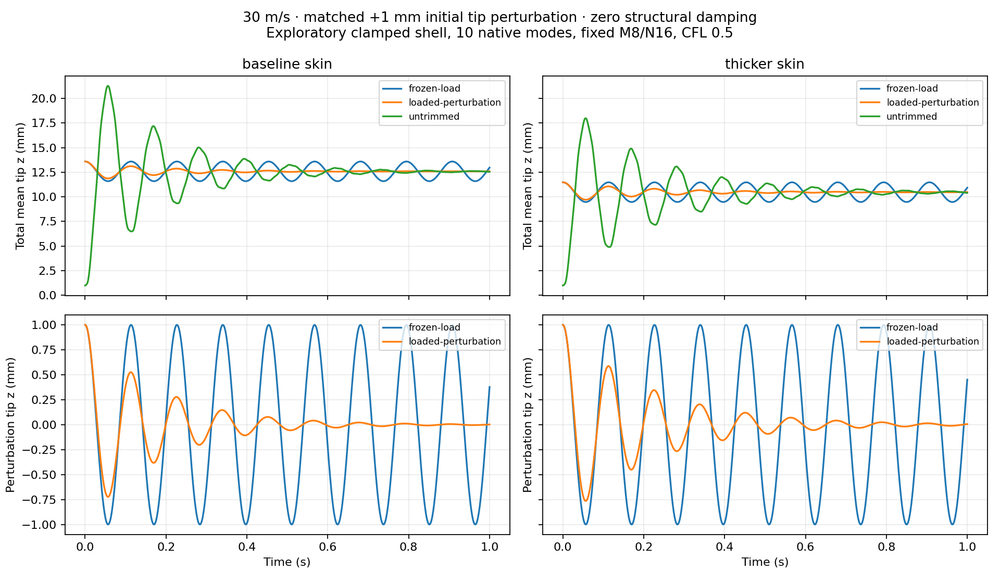

# Loaded equilibrium and first physical redesign

Issue #36 / stacked PR #37. Exploratory engineering experiment, 2026-10-29.
This follows the [native shell pilot](SHELL_COUPLED_PILOT.md). No new OpenFOAM
CFD runs were used. It is not flutter qualification or a flight claim.

At 30 m/s, the cambered shell has a nonzero aerodynamic load. Separating that
loaded equilibrium from its perturbation reveals that the previous untrimmed
20 mm stop was encountered during load-on overshoot. In this longer experiment,
the baseline overshoots to 21.27 mm mean tip z and settles near 12.54 mm.
The loaded-reference perturbation decays; the frozen-load, zero-damping
structural control continues oscillating.

| Quantity | .050 inch baseline | .060 inch skin |
|---|---:|---:|
| Half-wing mass (kg) | 0.905143 | 1.086172 |
| First native bending frequency (Hz) | 8.810675 | 8.823477 |
| Loaded mean tip z (mm) | 12.5909 | 10.4787 |
| Untrimmed peak mean tip z (mm) | 21.2714 | 17.9842 |
| Loaded perturbation late tip-peak decay fit (1/s) | -5.6473 | -4.6952 |
| Static finite-difference / reduced UVLM slope discrepancy | 0.1171% | 0.1174% |

The thicker shell reduces loaded tip displacement by 16.8%, costs 20% mass,
and barely changes the first bending frequency. Both section stiffness and mass
increase with thickness in this model. The decay fit becomes less negative:
less static deflection does not automatically imply stronger aerodynamic damping.
These are observations for this one model and operating point, not a design optimum.



## Experiment definition

Both variants use the same midsurface geometry, material, clamped root, 49 span
stations, 64 perimeter nodes, and paired-skin camber interpolation. The sole
physical change is PSHELL thickness, .00127 to .001524 m. MYSTRAN 19 regenerated
static bending, torsion and 30 native modes; the first ten modes are retained
in coupling. Native generalized masses remain one, and the thicker shell's
recomputed mass Gram discrepancy is 2.8e-8. Existing rotational massless DOF /
AUTOSPC limitations remain; see the prior shell readiness evidence.

Aerodynamics uses one mirrored full-span surface, M8/N16 per half, eight chord
wake, CFL .5, rho 1.225 kg/m³, speed 30 m/s, timestep .0002116667 s, and the
same rank-six observability Krylov procedure as the pilot. Inputs are SI.
Axes are x chord, y span, z up. Tip twist is the small-angle fitted rotation
about +y: sum((z-zc)ux-(x-xc)uz)/sum((z-zc)^2+(x-xc)^2), using tip-ring nodes.

The nonlinear static aerodynamic solve is repeated on the displaced camber
until Kq-Q(q)=0. Structural stiffness and the original native modal basis stay
linear: no prestress, geometric structural stiffness update, or free-flight
trim. Wake stays straight in the freestream direction. Force residual norms
relative to projected aerodynamic load are below 6e-16 for both variants.
This is numerical balance in the chosen reduced model, not physical validation.

Three histories per variant start with +1 mm mean tip z in the first native
mode and zero **physical** velocity:

- Frozen load: fixed equilibrium force, no aerodynamic feedback, oscillations
  about the loaded shape, zero structural damping.
- Loaded perturbation: UVLM reassembled about the loaded camber, zero initial
  incremental circulation, feedback active, zero structural damping.
- Untrimmed: load switched on about the original undeformed camber, plus the
  same initial physical tip displacement and incremental feedback.

Newmark state variables are transformed coordinates. Initialization solves for
the internal structural state including force feedthrough before converting the
UVLM predictor state; it does not assume internal state entries equal physical
q or velocity. Initial physical-state error is checked below 1e-10.

Each history runs just over one second. The experimental stop is now 50 mm
maximum absolute displacement component over **native shell nodes**, not the
previous 20 mm aerodynamic-grid guard. No new case reaches it. Neither value
is a structural allowable. All recorded q are total coordinates; each case
also carries its reference q. The untrimmed reference is zero, not its final
settling location. Full mirrored unit-mass coordinates map to native half-wing
motion by division by sqrt(2).

## Checks and reproducibility

[Evidence JSON](evidence/shell-loaded-equilibrium-20261029.json) records hashes,
frequencies, equilibrium coordinates, native provenance, residuals, guards,
initialization errors, and history metrics. Large native inputs, matrices,
frame arrays and solver logs remain in `runs/loaded-equilibrium-20261029/`.

- Zero perturbation holds the loaded reference exactly in the incremental model.
- Frozen-load modal coordinates agree with the analytic discrete Newmark cosine
  solution to below 1e-10. Tiny nonzero sampled peak-fit slopes are sampling error.
- All six cases begin with a physical +1 mm mean tip displacement relative to
  their own reference. Initial velocity is zero.
- Central static aerodynamic finite differences (one micrometre maximum lattice
  movement per mode) agree with reduced DC displacement slopes within .12%.
  This is a static consistency check, not broadband ROM or mesh qualification.
- Untrimmed positive peaks are **not** fit as decay about zero: their nonzero
  settling offset would make that fit misleading.

Retained experiment sources are `scripts/experiments/shell_loaded_equilibrium.py`,
`check_loaded_equilibrium.py`, and `export_equilibrium_comparison.py`.
Native preparation sources and their hashes are retained with the run:
`build-variant.py`, `characterize.py`, `export-camber.py`, and the exact copy of
`generate_aluminum_shell.py`. Baseline native extraction comes from the prior
`runs/shell-modal-bridge-20261027/fine30-modal.npz`. Both per-model folders hold
`native-modal.npz` and `camber-M8-N16.npz` inputs.

Run the solver and check scripts in the pinned SHARPy container from the pilot,
with the experiment source directory mounted read-only at `/experiment`, the
pinned SHARPy source at `/src`, `PYTHONPATH=/src`, and a fresh prepared results
directory at `/results`. Use `OPENBLAS_NUM_THREADS=1`, four CPUs and no network.
The solver refuses existing output directories. Then on the host:

```sh
python3 scripts/experiments/export_equilibrium_comparison.py runs/loaded-equilibrium-20261029
```

The next useful physics experiment is a single-variable mode-count or wake/time
resolution check on this loaded-reference case. Keep physical redesign studies
small and interpretable; do not begin an automated optimization loop yet.

## Offline synchronized preview

Download [wing-equilibrium-comparison.html](../viewers/wing-equilibrium-comparison.html)
and open it locally. Choose any two of the six histories. Both views share physical
time, camera and magnification; the tip displacement and twist plots use common
axes for the selected pair. Total and perturbation-about-reference modes change
both geometry and physical metrics. Perturbation geometry is drawn on the original
mesh for comparison, with the equilibrium offset removed. The previous pilot
viewer remains available as historical evidence.

```sh
python3 scripts/build_equilibrium_comparison.py \
  --data runs/loaded-equilibrium-20261029/comparison-data.json \
  --output viewers/wing-equilibrium-comparison.html
```

The builder refuses overwrites. Verification: 166 repository unit tests pass.
Headless Chromium checked both panels against independent NumPy values for 48
case/mode/time combinations, including interpolated q, tip z, fitted twist,
shared projection, physical-value invariance under magnification, end-of-history
stopping, a synthetic shorter guarded history, responsive layout and zero external
network requests. Browser script, expected values and result hashes are recorded
in the evidence JSON. The first worker viewer draft needed primary correction;
unit tests alone did not verify its browser behavior. The worker delivery command
also failed the known main-base check after pushing its commits to the intended
stacked PR; primary inspected the actual head and acknowledged the failed run.
