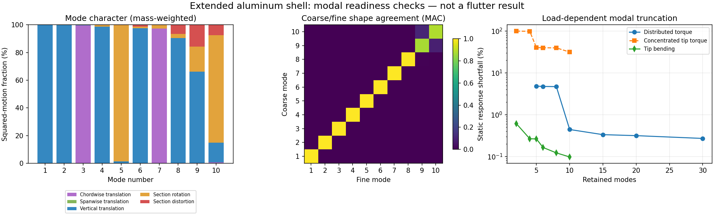

# Shell modal interface readiness

Primary assessment, 2026-10-27; issue34. This establishes modal data and kinematic/
load transfer for the extended aluminum surrogate. **No coupled aeroelastic
stability solve or flutter speed has been calculated in this assessment.**
The staged work is recorded in [FSI_FLUTTER_PLAN.md](FSI_FLUTTER_PLAN.md).

## Native modal data

Reconstructed the MYSTRAN lumped translational nodal mass from each quadrilateral's
area times rho times thickness, divided equally among its four corners. This is
confirmed by pinned MYSTRAN19 source `Source/EMG/EMG4/QDEL1.f90:184` and
`SHELL_ABD_MATRICES.f90:154`. No artificial shell rotational inertia was added.

For the 3136-node fine mesh, native printed mode vectors satisfy Phi^T M Phi=I to
maximum absolute error 3.01e-8. All root translations are zero. Native generalized
masses are 1. Modal stiffness is diag((2*pi*f)^2) under that normalization. Printed
F06 precision bounds these checks; they are not a general Nastran binary importer.
Only physical translations are needed for this translational mass and point-force
interface; shell rotational DOFs remain part of the native eigenproblem.

A new native SOL103 run extracted 30 positive modes (8.81–838.56Hz) and a native
SOL101 run applied a smooth span-distributed torque. Both terminated normally.
The same 9216 nonzero mass-diagonal warning occurs in modal output, and 96 rotational
AUTOSPCs remain; no translational AUTOSPC or fatal errors. Static output has no
warnings, and force/moment balance errors are under 1e-6 at output precision.
No CFD runs were started.

## Mode identification and mesh sensitivity

Fit each station's translations with weighted rigid-section motion
u=t+theta cross (x-center), using the same nodal masses. Report residual squared
motion divided by total mass-weighted squared motion. These fractions describe
kinematics/kinetic energy for a mode; they are NOT strain-energy fractions.

| Mode | Fine frequency Hz | Dominant character | Section-distortion fraction | Coarse/fine MAC |
| --- | ---: | --- | ---: | ---: |
| 1 |8.8107|First vertical bending|<0.001%|0.9999998|
| 2 |53.7757|Second vertical bending|0.002%|0.9999842|
| 3 |56.4344|First chordwise/in-plane bending|<0.001%|0.9999992|
| 4 |143.1312|Higher vertical bending|0.098%|0.9998517|
| 5 |169.4779|First torsion-dominated|0.059%|0.9999818|
| 6 |257.1314|Vertical bending with distortion|1.233%|0.9990719|
| 7 |341.2641|Higher in-plane bending|0.091%|0.9996756|
| 8 |366.2999|Mixed vertical/local section motion|6.531%|0.9930689|
| 9 |446.9751|Mixed section motion|15.728%|0.8703682|
| 10 |453.9331|Rotation-dominated mixed motion|7.484%|0.8803101|

MAC uses mass-weighted native vectors at exactly coincident coarse/fine points.
The first seven frequency changes are under 0.86%; modes 9/10 are not sufficiently resolved
for a blanket converged-spectrum claim. Higher modal subspaces may mix. Initial
identification is based on component motion and station fits; no flutter mechanism
is inferred from frequency proximity alone.

## Modal truncation is load-dependent

Ten modes recover the native tip-bending compliance to 0.098%, but underpredict
concentrated tip-torque compliance by 31.49%. This reflects important local end
response, not permission to tune GJ until a truncated basis matches the tip.

A second native load distributes the same +1 N m torque smoothly along the span,
with zero resultant force and zero applied load at root/tip stations. The modal
response is compared with a complete native static solve under identical forces:

| Retained modes | Work/compliance shortfall | Mass-weighted displacement error |
| ---: | ---: | ---: |
|5|4.823%|6.773%|
|10|0.442%|1.103%|
|15|0.333%|0.722%|
|20|0.316%|0.660%|
|30|0.271%|0.496%|

This supports starting with 10 modes and checking 20/30 in subsequent coupling;
it does not prove flutter truncation convergence. Stop further generic modal
extraction now: resolving actual aerodynamic feedback is the next useful check.

## Direct shell-to-camber interface

Rather than forcing every section into a beam, interpolate paired upper/lower
skin translations in native mean-line-coordinate and span, and average the pair.
Define aerodynamic reference points with those identical weights applied to shell
reference coordinates. This preserves native camber motion, including local
section distortion, in a thin lifting-surface approximation. Thickness-breathing
effects on aerodynamics are omitted explicitly.

For modal coordinates q, use u_a=H_a q and Q=H_a^T f_a. Velocity uses the same H_a.
The sparse skin-to-camber weight map W provides f_shell=W^T f_a. Because weights
sum to 1 and x_a=W x_shell, rigid motions, resultant forces, resultant moments and
virtual work are preserved. Verify the same reference/frame/order at solver input.
No axis conversion or rigid-section reduction is implicit in `modal_surface.py`.

Checked 4x8, 8x16, 12x24 chord/span panel grids with 30 modes: maximum rigid-motion
error 1.39e-17 m, force/moment errors <1.3e-14 N/Nm, virtual-work errors <5e-18 J.
These are kinematic/numerical checks, not aerodynamic resolution convergence.

## Next gate

Connect the mapped native modes to pinned SHARPy UVLM displacement AND velocity
inputs and project its vertex forces with the same transpose. Determine the root
wall/symmetry treatment explicitly; a bare half-wing aerodynamic grid has a root
edge vortex and is not automatically the owner's wall-mounted configuration.
Check the reference aerodynamic/structural equilibrium, zero-flow structural
limit, force signs, time discretization and coupled benchmark before speed sweeps.
The existing Goland beam adapter cannot just receive replacement frequencies.
No damping value is measured; zero damping must remain a declared assumption.

Evidence: [summary JSON](evidence/shell-modal-interface-20261027.json).
Native results and reproducible primary scripts retained under
`runs/shell-modal-bridge-20261027/`: characterize.py, check-reduction.py,
run-extended-modes.py, check-distributed.py, build-camber-interface.py, summarize.py.
Their hashes and native input/output hashes are recorded in the summary. Analysis
uses existing host NumPy 2.4.4; repository modal utility needs only Python stdlib.
Large mode arrays/native output remain outside Git. Source generator PR31 head
2894b079b1863567c39ebc6155d3c8257c1cc4c0; MYSTRAN19 source
3a5913a904ee1adbda9fbcaf9c0a6af8e10f0f9f. Shared-memory sources used:
f8a6e43518dd49ee324c2160bae47aa7 (explicit modal normalization/DOF maps),
2aee74c032f370138af1664e4baa0aaa (shell AUTOSPC sensitivity), and
b6124a38aa49c8faca9ef4e8b35fb0a4 (SHARPy benchmark scope).
